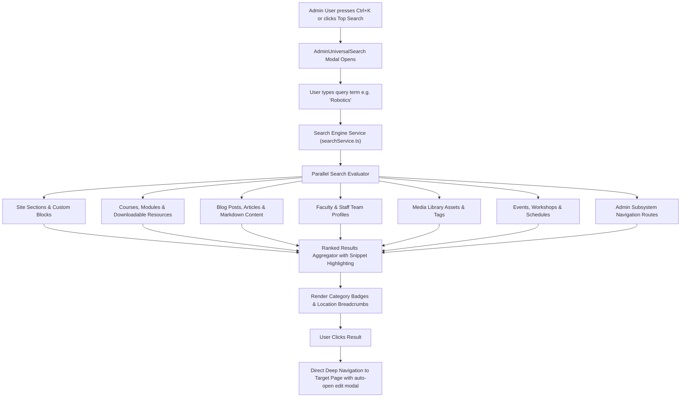
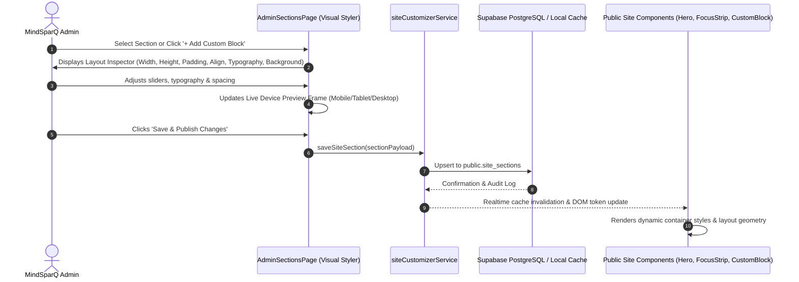
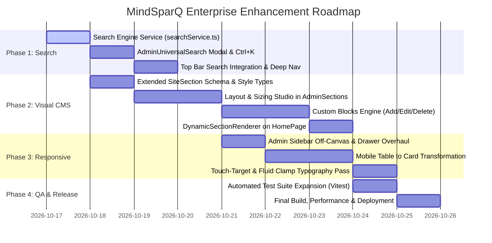

# MindSparQ Enterprise Architecture Plan: Universal Search, Visual CMS Styler & Device Responsiveness

**Document Version**: 2.0.0-ENTERPRISE  
**Target Environment**: React 18, TypeScript, Supabase PostgreSQL, Cloudflare Pages  
**Architecture Lead**: MindSparQ Principal System Architect  
**Approved Domain**: [https://mindsparqeducation.com.np](https://mindsparqeducation.com.np)

---

## 1. Executive Summary & Problem Formulation

Based on the strategic directives from MindSparQ leadership, the platform is undergoing a major evolution to achieve **WordPress-grade flexibility**, **instant universal content discovery**, and **flawless cross-device responsive excellence**.

```
┌────────────────────────────────────────────────────────────────────────────────────────┐
│                               MINDSPARQ CMS ECOSYSTEM                                   │
├──────────────────────────┬─────────────────────────────┬───────────────────────────────┤
│  1. Universal Search     │  2. WordPress-Grade Styler  │  3. Pixel-Perfect Responsive  │
│  • Ctrl+K Command Bar    │  • Layout Dimensions Studio │  • Mobile Drawer Navigation   │
│  • Deep Content Indexing │  • Spacing, Height & Align  │  • Horizontal Table Cards     │
│  • Exact Location Jump   │  • Extensible Custom Blocks │  • Fluid Clamp() Typography   │
│  • 1-Click Direct Edit   │  • Real-time Split Preview  │  • 44px Touch Target Standard │
└──────────────────────────┴─────────────────────────────┴───────────────────────────────┘
```

### Critical Objectives:
1. **Universal Admin Content Search (`Ctrl + K` / Top Header Bar)**: A high-performance global search engine indexing all database entities (courses, lessons, blog posts, sections, media, events, team profiles, and settings) with snippet highlights, file/record location badges, and direct 1-click edit navigation.
2. **WordPress-Grade Visual Section & Template Studio**: Empower administrators to modify and customize every section's layout: container width, section min-height, top/bottom padding, typography scales, content alignment (left/center/right/split), background overlays/images, and add brand-new custom blocks (Rich Text, Feature Grids, Video Showcases, Stat Strips, FAQ Accordions) without touching code.
3. **Flawless Multi-Device Responsiveness (Mobile, Tablet, Desktop)**: Complete overhaul of mobile ergonomics—repairing admin sidebar sliding drawers, fixing table overflows with mobile responsive cards, fluid typography scaling, and touch-target optimization.

---

## 2. System Architecture & Workflows

### 2.1 Universal Admin Content Search Architecture



### 2.2 WordPress-Grade Section Layout & Styler Pipeline



---

## 3. Detailed Technical Specifications

### 3.1 Pillar 1: Universal Admin Content Search (`AdminUniversalSearch`)

#### Location & Trigger:
* Fixed in the **Admin Top Bar Header** (`AdminLayout.tsx`), visible on both desktop and mobile viewports.
* Global keyboard shortcut listener for `Ctrl + K` (Windows/Linux) and `⌘ + K` (macOS), plus single-click activation.

#### Deep Index Data Contract:
```typescript
export interface SearchIndexResult {
  id: string;
  title: string;
  subtitle?: string;
  snippet: string;
  category: 'section' | 'course' | 'lesson' | 'blog' | 'team' | 'media' | 'event' | 'navigation' | 'user';
  categoryLabel: string;
  locationPath: string; // e.g., "Homepage > About Snippet" or "Courses > AI Level 1"
  targetRoute: string; // e.g., "/admin/sections?edit=about_snippet"
  badgeColor: string;
  updatedAt?: string;
}
```

#### Searchable Entity Mapping:
| Category | Source Data | Searchable Fields | Destination Action |
| :--- | :--- | :--- | :--- |
| **Site Sections** | `site_sections` / `DEFAULT_SECTIONS` | Title, subtitle, badge, content JSON (pillars, location, stats) | Opens `/admin/sections` with target section modal open |
| **Courses** | `courses` / `courseService` | Title, description, age group, prerequisites, syllabus topics | Navigates to `/admin/courses?edit={id}` |
| **Lessons** | `lessons` / `curriculum` | Title, summary, video URL, downloadable resource titles | Navigates to `/admin/courses?courseId={course_id}&lessonId={id}` |
| **Blog Articles** | `blog_posts` / `blogService` | Title, excerpt, markdown body, author name, category, tags | Navigates to `/admin/blog?edit={id}` |
| **Team Profiles** | `team_profiles` / `staff` | Full name, role title, specialization, bio, qualification | Navigates to `/admin/team?edit={id}` |
| **Media Library** | `media_assets` / `mediaService` | File title, filename, alt text, tags, MIME type | Opens `/admin/media?highlight={id}` |
| **Events** | `events` / `eventService` | Event title, description, venue, agenda highlights | Navigates to `/admin/events?edit={id}` |
| **Quick Nav** | Admin System Routes | Navigation labels (Settings, Audit, AI Chatbot, Users) | Instant route transition |

---

### 3.2 Pillar 2: WordPress-Grade Visual Customizer & Dynamic Template Engine

#### Enhanced Schema: `SiteSection` Layout & Styling Tokens
We extend `SiteSection` in `src/services/siteCustomizerService.ts` and database table `site_sections`:

```typescript
export interface SectionLayoutStyle {
  containerWidth: 'narrow' | 'standard' | 'wide' | 'full'; // 960px | 1200px | 1440px | 100%
  minHeight: 'auto' | 'compact' | 'medium' | 'screen' | 'custom'; // auto | 360px | 600px | 100vh | px
  customHeightPx?: number;
  paddingTop: 'none' | 'sm' | 'md' | 'lg' | 'xl'; // 0 | 24px | 48px | 80px | 120px
  paddingBottom: 'none' | 'sm' | 'md' | 'lg' | 'xl';
  alignment: 'left' | 'center' | 'right' | 'split';
  headingScale: 'sm' | 'md' | 'lg' | 'display'; // clamp scales
  backgroundColor?: string; // hex or CSS var
  backgroundGradient?: string; // CSS linear gradient
  backgroundImageUrl?: string;
  backgroundOverlayOpacity?: number; // 0 to 1
  ctaButtonText?: string;
  ctaButtonUrl?: string;
  ctaButtonTarget?: '_self' | '_blank';
  secondaryButtonText?: string;
  secondaryButtonUrl?: string;
  customCssClasses?: string;
}

export type CustomBlockType = 
  | 'hero'
  | 'rich_text'
  | 'feature_grid'
  | 'split_media'
  | 'stats_strip'
  | 'video_showcase'
  | 'faq_accordion'
  | 'cta_banner';

export interface SiteSection {
  id: string;
  key: string;
  name: string;
  title: string;
  subtitle: string;
  badge?: string;
  is_visible: boolean;
  sort_order: number;
  block_type?: CustomBlockType;
  layout_style?: SectionLayoutStyle;
  content_json: Record<string, any>;
}
```

#### New Custom Block Types:
1. **Rich Text / Editorial Block**: Custom markdown or formatted prose with typography styling, bullet points, and CTA.
2. **Feature Grid (3 or 4 Cards)**: Title, icon preset, description, link.
3. **Split Media Hero**: 50/50 split with image/video on left/right and copy + dual CTA buttons on the opposite side.
4. **Statistics Counter Strip**: 4 highlight metrics (e.g. 5,000+ Students, 15+ Robotics Labs, 100% Practical).
5. **Video Showcase Embed**: Responsive 16:9 YouTube/Vimeo embed with custom backdrop and headline.
6. **FAQ Accordion Block**: Expandable Q&A accordion list for admissions, fees, and program details.
7. **Call-to-Action Banner**: High-impact colored card with primary & secondary buttons.

#### Public Site Rendering Engine (`DynamicSectionRenderer`):
Every section rendered on `HomePage.tsx` and public pages will be wrapped in `DynamicSectionWrapper`:
* Sets CSS custom properties for max-width, padding, height, and alignment dynamically.
* Renders custom backgrounds with dark glass overlays and backdrop filters.
* Gracefully falls back to default styling if no custom styles are specified.

---

### 3.3 Pillar 3: Multi-Device Responsive Architecture (Mobile, Tablet, Desktop)

#### 1. Admin Console Mobile Overhaul:
* **Off-Canvas Sidebar Drawer**:
  * Desktop ($\ge 1024\text{px}$): Permanent 260px sticky sidebar.
  * Mobile/Tablet ($< 1024\text{px}$): Off-screen with CSS `transform: translateX(-100%)`. On menu tap, smoothly slides in with `transform: translateX(0)`, backdrop overlay (`rgba(0,0,0,0.6)`), and dedicated close button.
* **Responsive Admin Data Tables**:
  * Implement an automatic dual-mode table component:
    * Standard desktop table layout with sticky headers.
    * Mobile card layout (`@media (max-width: 768px)`): Data rows transform into structured vertical cards with bold attribute labels, ensuring zero horizontal cutoff or page blowout.
* **Touch-Friendly Controls**:
  * Minimum touch target size $\ge 44 \times 44\text{px}$ across all mobile buttons, dropdowns, and toggles.

#### 2. Public Site Mobile Overhaul:
* **Fluid Clamp Typography**:
  * `clamp(1.75rem, 5vw, 3.25rem)` for hero titles.
  * `clamp(1.25rem, 3.5vw, 2.25rem)` for section headings.
* **Ad Rails & Promotion Responsive Behavior**:
  * Desktop ($\ge 1280\text{px}$): 3-column layout (Left Ad Rail, Center Content, Right Ad Rail).
  * Mobile/Tablet ($< 1280\text{px}$): Ad rails automatically morph into non-intrusive in-feed mobile promo cards placed naturally between content blocks.
* **Responsive Video & Image Embeds**:
  * Strict `aspect-ratio: 16/9` containers preventing layout shifts (CLS = 0).

---

## 4. Phased Implementation Roadmap



### Phase Breakdown

#### Phase 1: Universal Admin Content Search Engine
* [ ] Create `src/services/searchService.ts` aggregating content from all services (`siteCustomizerService`, `courseService`, `blogService`, `mediaService`, `eventService`, `teamService`, `userService`).
* [ ] Build `src/components/admin/AdminUniversalSearch.tsx` command palette modal with keyword matching, snippet extraction, and keyboard navigation (Arrow Up/Down, Enter, Esc).
* [ ] Integrate search trigger into `src/components/admin/AdminLayout.tsx` top bar with `Ctrl + K` global shortcut.
* [ ] Implement deep navigation handler that routes to target admin pages and opens target editing states.

#### Phase 2: WordPress-Grade Visual Section & Template Styler
* [ ] Extend `SiteSection` interface with `layout_style` and `block_type` definitions in `src/services/siteCustomizerService.ts`.
* [ ] Create `src/components/admin/SectionLayoutInspector.tsx` offering sliders, pickers, and toggles for container width, padding, height, alignment, typography scale, and background styles.
* [ ] Add dynamic "+ Add New Custom Block" functionality to `src/pages/admin/AdminSectionsPage.tsx` supporting Rich Text, Feature Grids, Video Embeds, Stats Strips, and CTA Banners.
* [ ] Build `src/components/home/DynamicSectionWrapper.tsx` and custom block renderers to apply layout geometry to public pages.
* [ ] Implement live responsive preview tab (Mobile, Tablet, Desktop) inside `AdminSectionsPage.tsx`.

#### Phase 3: Comprehensive Multi-Device Responsive Overhaul
* [ ] Overhaul `AdminLayout.tsx` and `src/styles/admin.css` (or `global.css`) with off-canvas sidebar drawer for `< 1024px`, animated backdrop, and mobile close button.
* [ ] Implement responsive table containers and mobile card view styles for `AdminCoursesPage`, `AdminUsersPage`, `AdminBlogPage`, and `AdminEventsPage`.
* [ ] Update `Header.tsx` and public layouts with fluid typography (`clamp()`) and touch-target standards ($\ge 44\text{px}$).

#### Phase 4: Automated Testing, Quality Assurance & Production Build
* [ ] Write comprehensive unit and integration tests in `src/test/searchService.test.ts` and `src/test/visualStyler.test.ts`.
* [ ] Validate cross-device viewports (360px mobile, 768px tablet, 1024px laptop, 1440px desktop).
* [ ] Execute `npm run typecheck`, `npm run test`, and `npm run build` to verify zero errors and clean bundle output.

---

## 5. Verification & Acceptance Criteria

1. **Search Precision**: Querying any keyword (e.g. "Abacus", "Robotics", "Kalikanagar", "Faculty", "Syllabus") in the top admin search bar returns immediate, categorized results showing the exact file/table location and provides 1-click navigation to edit that item.
2. **Visual CMS Flexibility**: Administrators can change section height, container width, top/bottom padding, typography scale, alignment, or add brand-new custom blocks with instant preview and zero code modifications.
3. **Responsive Stability**: On mobile phones (360px–420px), the admin sidebar smoothly slides in/out, data tables collapse gracefully into card format with no horizontal page scroll, and all touch targets are $\ge 44\text{px}$.
4. **Zero Regressions**: 100% pass rate across existing 57 tests, zero TypeScript errors, and flawless production compilation.
