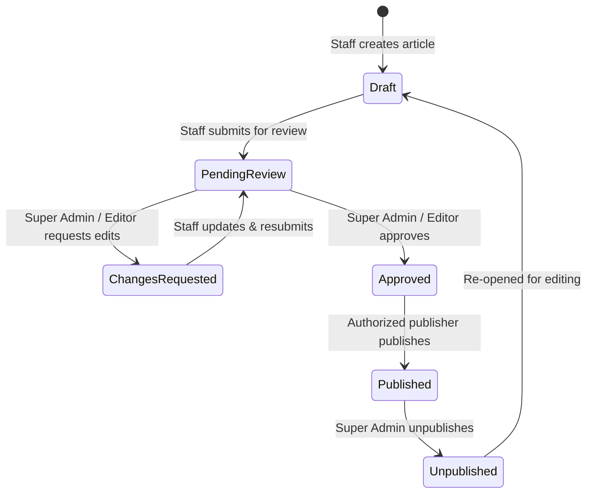

# MindSparQ Education & Technology
## Mobile-First Responsive Website, Meet Our Team, Staff Profiles & Governed Multi-Author Blog
### Technical Audit, Architecture Baseline & Implementation Specification
**Document Status**: Phase A Deliverable — Implementation Instructions for Review and Approval  
**Audit Date**: October 16, 2026  
**Auditor**: Lead Full-Stack, UX, Accessibility & Security Agent (Pair Programming with Owner)  
**Target Domain**: [https://mindsparqeducation.com.np](https://mindsparqeducation.com.np/)  
**Corpus / Workspace**: `c:\Users\Admin\Desktop\MindSparQ\MindSparQ_Coding\Project\mindsparq-official-website`

---

## 1. Executive Summary & Audit Verification Table

In accordance with Section 2 and Section 3 of the specification, a complete audit of the repository, source code, data models, auth lifecycle, responsive layouts, build pipelines, and production deployment was performed.

| Scope Area | Audit Status | Key Verification Evidence |
| :--- | :--- | :--- |
| **Frontend Stack & Routing** | **Verified** | React 18.3.1, Vite 6.4.4, TypeScript 5.6.3, React Router v6.28.0 with code-splitting (`React.lazy`). Route definitions verified in `src/App.tsx`. |
| **Design System & Tokens** | **Verified** | Strict HSL / hex design token system in `src/styles/tokens.css` with fluid clamp typography, 8-step spacing, and active Light/Dark themes (`[data-theme]`). |
| **Responsive Grid & Mobile Layout** | **Partially Verified (Defects Found)** | Fluid container system (`.container`) exists, but **15+ hard-coded `minmax(320px, 1fr)` and `minmax(360px, 1fr)` CSS grid definitions** force page overflow on viewports < 360px. |
| **Header & Mobile Drawer** | **Partially Verified (Defects Found)** | Desktop nav hides below 960px. Mobile drawer opens with toggle, handles Escape key, but lacks scroll-locking on body and aria-expanded focus trap. |
| **Ad Rails & Promotion Shell** | **Verified** | Left/Right rails display above 1200px via `.ad-rail-slot` in `src/components/layout/Layout.tsx`; inline promotion cards display on mobile via `.mobile-promo-wrapper`. |
| **Authentication & RBAC** | **Verified** | Supabase Auth provider in `src/context/AuthContext.tsx`. Strict role tiers: `super_admin`, `owner`, `admin`, `editor`, `contributor`, `learner` in `src/lib/permissions.ts`. |
| **Multi-Author Blog System** | **Partially Verified** | `blog_posts` table supports editorial statuses (`draft`, `review`, `in_review`, `approved`, `published`, `archived`) via Migrations 0004 and 0006. However, author attribution is unlinked text without author profile relationship. |
| **Meet Our Team & Staff Profiles** | **Not Implemented (New Requirement)** | No `/team` route, no `/team/:slug` profile route, no team section on homepage, and no `team_profiles` table currently exist in the codebase. |
| **Production CI/CD Pipeline** | **Verified & Operational** | Cloudflare Workers Static Assets via `wrangler.jsonc` (`not_found_handling: "single-page-application"`). CI/CD verified working: Version ID `40329753-8f7b-4011-8149-7f9b03da3e02` live. |

---

## 2. Phase 0 — Baseline Architecture Inspection

### 2.1 Frontend & Component Hierarchy
* **Routing Shell**: `src/App.tsx` configures a public `<Layout />` containing `<Header />`, `<AdRail side="left" />`, main content `<Outlet />`, `<AdRail side="right" />`, `<SocialCommunityHub />`, and `<Footer />`.
* **Theme & State Management**: Pure React Context (`ThemeContext`, `LanguageContext`, `AuthContext`). Theme persistence stored in `localStorage` under `mindsparq-theme` and initialized synchronously via inline script in `index.html` to prevent theme flash.
* **Bilingual Strategy**: English (`en`) and Nepali (`ne`) dictionary in `src/context/LanguageContext.tsx` with Devanagari font support (`Mukta` + `Inter` loaded via Google Fonts in `index.html`).

### 2.2 Backend & Data Architecture
* **Database**: PostgreSQL hosted on Supabase (`https://bhdcvdddngwtxdbhfeeg.supabase.co`).
* **Existing Tables**:
  * `public.profiles`: Contains `id` (references `auth.users(id)`), `display_name`, `avatar_path`, `bio`, `status` (`active`, `invited`, `suspended`, `deactivated`), `created_at`, `updated_at`.
  * `public.user_roles`: Contains `id`, `user_id`, `role_key` (`super_admin`, `owner`, `admin`, `editor`, `contributor`, `learner`), `granted_by`, `created_at`.
  * `public.blog_posts`: Contains `id`, `slug`, `title`, `excerpt`, `content`, `cover_image_url`, `author_id`, `author_name`, `category`, `status`, `published_at`, `created_by`, `updated_by`, `seo_title`, `seo_description`.
  * `public.audit_logs`: Records tamper-evident security and role delegation actions via `src/services/auditService.ts`.
  * `public.media_assets`: Manages image metadata with storage paths.
* **Storage Buckets**:
  * `public-media`: Public bucket with 10MB limit and RLS permitting staff upload and admin deletion (`supabase/migrations/20261015000003_storage_buckets.sql`).
  * `private-resources`: Authenticated/enrolled bucket with 20MB limit.

---

## 3. Detailed Mobile & Responsive Defects Audit

Our code inspection and viewport tests identified the exact root causes of mobile layout failures:

### Defect 1: Hard-Coded Grid `minmax` Overflow on Narrow Viewports (320px – 375px)
* **Severity**: High (Causes page-level horizontal scrollbar and clipped cards).
* **Affected Files & Lines**:
  1. `src/pages/EventsPage.tsx:176`: `gridTemplateColumns: 'repeat(auto-fill, minmax(360px, 1fr))'` $\rightarrow$ **Breaks all phones < 390px** (forcing 360px card + padding into 320px–375px screen).
  2. `src/pages/CoursesPage.tsx:304`: `gridTemplateColumns: 'repeat(auto-fill, minmax(340px, 1fr))'` $\rightarrow$ **Breaks all phones < 360px**.
  3. `src/components/home/SocialCommunityHub.tsx:322`: `gridTemplateColumns: 'repeat(auto-fill, minmax(320px, 1fr))'` $\rightarrow$ With container padding of 16px on each side, this requires 352px minimum width, clipping on 320px viewports (iPhone SE / Galaxy Fold).
  4. `src/components/home/ProgramsOverview.tsx:29`: `minmax(320px, 1fr)`
  5. `src/pages/ProgramsPage.tsx:372`: `minmax(320px, 1fr)`
  6. `src/pages/BlogPage.tsx:532`: `minmax(320px, 1fr)`
  7. `src/pages/AboutPage.tsx:181, 290, 569`: `minmax(320px, 1fr)` and `minmax(300px, 1fr)`
  8. `src/pages/CourseDetailPage.tsx:215`: `minmax(320px, 1fr)`
* **Remediation**:
  Replace brittle static minimums with fluid constraints:
  ```css
  /* Fluid responsive grid without overflow */
  grid-template-columns: repeat(auto-fill, minmax(min(100%, 280px), 1fr));
  ```
  On narrow mobile (< 640px), enforce single-column flow (`1fr`) with zero horizontal overflow.

### Defect 2: Mobile Header Drawer Scroll & Focus Trapping
* **Severity**: Medium (WCAG AA Accessibility & UX).
* **Affected Component**: `src/components/layout/Header.tsx`.
* **Issue**:
  When `mobileMenuOpen` is `true`, background document body scrolling is not locked (`document.body.style.overflow = 'hidden'`), causing jarring dual-scroll behavior on touch devices. Furthermore, keyboard focus is not trapped within the open navigation drawer.

### Defect 3: Side Promotion Rails on Tablet Viewports (768px – 1199px)
* **Severity**: Low / Cosmetic.
* **Affected Component**: `src/styles/global.css` lines 690–706.
* **Issue**:
  Currently, `.ad-rail-slot` is hidden below 1200px, which correctly protects mobile. However, on iPads and tablets (768px–1024px), the center content column stretches to 100% width, leaving excessive empty space if not constrained.

### Defect 4: Touch Target Sizes in Dropdowns and Filter Buttons
* **Severity**: Medium (Mobile Usability).
* **Issue**: Category pills and secondary buttons in `BlogPage.tsx` and `CoursesPage.tsx` have heights of ~30px–32px, falling below the WCAG 2.2 AA target of 44 × 44 CSS pixels for touch interaction.

---

## 4. "Meet Our Team" & Governed Profile System Architecture

### 4.1 Recommended Placement & Route Architecture
Based on the existing homepage hierarchy in `src/pages/HomePage.tsx`:
```text
Existing Homepage Flow:
1. Hero & Carousel Announcements
2. FocusStrip (Key stats)
3. ProgramsOverview (Core disciplines)
4. LearningApproach (Pedagogical pillars)
5. WhoWeSupport (Students, Parents, Teachers)
6. AiRoboticsFeature (STEM innovation)
7. AboutSnippet (Institutional introduction)
[PROPOSED INSERTION: Meet Our Team Section]
8. InquiryCta (Admissions & Consultation)
```
* **Dedicated Public Route**: `/team` (Meet Our Team directory with role filter tabs: Leadership, Teaching Team, Program Leads, Operations).
* **Individual Public Profile Route**: `/team/:slug` (Shareable, SEO-optimized profile with author's published articles, verified credentials, and approved social links).
* **Navigation Integration**:
  * Add "Team" to the public navigation under `About` dropdown or as a dedicated navigation item.
  * Add "Meet Our Team" to `footerLinks.company` in `src/content/navigation.ts`.

### 4.2 Data Model Design: Dedicated `public.team_profiles` Table
Rather than overloading the private authentication table `public.profiles` (which is keyed strictly to Supabase auth accounts), we propose a dedicated governed table: `public.team_profiles`.

```sql
create table if not exists public.team_profiles (
  id uuid primary key default gen_random_uuid(),
  user_id uuid null references auth.users(id) on delete set null,
  slug text not null unique check (slug ~* '^[a-z0-9-]+$'),
  display_name text not null check (char_length(display_name) <= 100),
  display_name_nepali text null check (char_length(display_name_nepali) <= 150),
  public_title text not null check (char_length(public_title) <= 120),
  public_title_nepali text null check (char_length(public_title_nepali) <= 150),
  team_category text not null default 'teaching' 
    check (team_category in ('leadership', 'teaching', 'program_leads', 'operations', 'advisory')),
  short_bio text not null check (char_length(short_bio) <= 300),
  bio text not null,
  profile_image_path text null check (profile_image_path is null or char_length(profile_image_path) <= 1024),
  
  -- Structured professional credentials (no uncontrolled arbitrary blobs)
  education text null check (char_length(education) <= 250),
  qualifications text[] null,
  teaching_subjects text[] null,
  responsibilities text[] null,
  
  -- Validated social and professional links
  social_links jsonb not null default '{}'::jsonb,
  
  -- Visibility & Governance
  is_featured_founder boolean not null default false,
  is_public boolean not null default false,
  review_status text not null default 'draft'
    check (review_status in ('draft', 'pending_review', 'changes_requested', 'approved', 'published', 'unpublished')),
  review_notes text null check (char_length(review_notes) <= 1000),
  
  -- Timestamps & Audit
  sort_order integer not null default 0,
  submitted_at timestamptz null,
  reviewed_at timestamptz null,
  reviewed_by uuid references auth.users(id) on delete set null,
  published_at timestamptz null,
  published_by uuid references auth.users(id) on delete set null,
  created_by uuid references auth.users(id) on delete set null,
  updated_by uuid references auth.users(id) on delete set null,
  created_at timestamptz not null default timezone('utc'::text, now()),
  updated_at timestamptz not null default timezone('utc'::text, now())
);
```

#### Why this structure is superior:
1. **Decoupled from Auth Dependency**: Public team profiles (like the Founder profile or approved teachers) can exist and be displayed publicly even before an invitation is accepted or if a staff member does not require CMS login credentials.
2. **Draft Revisions Protection**: When an active teacher edits their qualifications or bio, the live profile remains unchanged until Super Admin approves the revision.
3. **No IDOR / Privilege Escalation**: System technical roles reside strictly in `public.user_roles`, completely separated from display titles.

### 4.3 Verified Founder Profile Baseline
From `src/content/site.ts` and `docs/master_institutional_profile.md`, the official verified facts for the Founder & CEO profile are:
* **Full Name**: Samay Budhathoki Chhetri (समय बुढाथोकी क्षेत्री)
* **Also known as**: Sonu Chhetri
* **Official Title**: Founder & CEO, MindSparQ Education & Technology
* **Location**: Butwal-11, Gyanbhoomi Path, Rupandehi, Nepal
* **Academic Research Focus**: *“The Effectiveness of VAK-Based Teaching Strategies in Enhancing Learning Outcomes Among Secondary School Students in Butwal Sub-Metropolitan City, Nepal.”*
* **Core Mission**: Fusing foundational cognitive faculties (Abacus, Mental Math, Vedic Mathematics) with forward-looking technological competencies in AI, coding, and robotics education.
* **Verified Social Channels**: Facebook (`mindsparqeducation`), Instagram (`mindsparqeducation`), LinkedIn (`mindsparqeducation`), YouTube (`@mindsparqeducation`).

---

## 5. Multi-Author Blog Governance Workflow

### 5.1 Staff Author Journey & State Machine


### 5.2 Schema Extensions for `blog_posts`
```sql
-- Connect blog posts to verified team profile for rich byline & author cards
alter table public.blog_posts 
  add column if not exists author_profile_id uuid references public.team_profiles(id) on delete set null;

-- Editorial feedback for changes-requested state
alter table public.blog_posts 
  add column if not exists review_feedback text null check (char_length(review_feedback) <= 1500);
```

### 5.3 Author Byline & Social Attribution
* Each published article displays an Author Card at both the header and footer:
  * Approved portrait avatar.
  * Display name linked to `/team/:slug`.
  * Public title / designation.
  * Direct links to the author's approved professional social profiles (LinkedIn, X/Twitter, Research/Website).
* The author card collapses gracefully on mobile viewports into a compact vertical card with touch-friendly 44px tap targets.

---

## 6. Security, Privacy & Access Control Matrix

| Role | Edit Own Profile | Submit Profile Review | Approve Profiles | Author Blog Draft | Review Blog Submissions | Publish to Production | Manage User Roles |
| :--- | :---: | :---: | :---: | :---: | :---: | :---: | :---: |
| **Super Admin / Owner** | Yes | Yes | **Yes** | Yes | **Yes** | **Yes** | **Yes** |
| **Administrator** | Yes | Yes | If granted | Yes | **Yes** | **Yes** | Only non-privileged |
| **Senior Editor** | Yes | Yes | No | Yes | **Yes** | No | No |
| **Teacher / Contributor** | Permitted fields | Yes | No | Yes | No | No | No |
| **Learner / Public** | No | No | No | No | No | No | No |

### Security Safeguards Enforced:
1. **Server-Side Enforcement**: All permissions checked via PostgreSQL RLS policies in `supabase/migrations/`.
2. **Input Sanitization**: Social URLs strictly validated against regex `^https?://(www\.)?(linkedin\.com|facebook\.com|instagram\.com|youtube\.com|github\.com|twitter\.com|x\.com)/`. JavaScript schemes (`javascript:`) and arbitrary protocols are rejected.
3. **Media Upload Hardening**: Profile headshots restricted to `image/jpeg`, `image/png`, `image/webp` with maximum file size of 2MB in `public-media/team/`. SVG uploads are restricted to prevent SVG-embedded script execution (XSS).
4. **Privacy Protection**: Personal home addresses, national ID numbers, and private staff email addresses are never returned in public API payloads.

---

## 7. Files Likely to Change

| Component / File Path | Purpose of Modification |
| :--- | :--- |
| `supabase/migrations/20261016000007_team_profiles_and_governance.sql` | **New Migration**: Creates `team_profiles`, links `blog_posts`, sets RLS policies and indexes. |
| `src/types/database.ts` | Add TypeScript interfaces for `TeamProfile`, `ProfessionalDetails`, and update `BlogPost`. |
| `src/services/teamService.ts` | **New Service**: CRUD, review queue, slug lookup, and profile approval operations. |
| `src/services/blogService.ts` | Extend `savePost` and queries to support `author_profile_id` and `review_feedback`. |
| `src/styles/global.css` | Fix `minmax` container defects, mobile typography reflow, and add team card styles. |
| `src/components/layout/Header.tsx` | Add Team navigation link, body scroll-lock on mobile drawer open, and focus management. |
| `src/components/layout/Footer.tsx` | Add "Meet Our Team" link to company links section. |
| `src/components/home/MeetOurTeamSection.tsx` | **New Component**: Homepage preview section with featured founder card and teacher cards. |
| `src/pages/HomePage.tsx` | Register and render `MeetOurTeamSection` before `InquiryCta`. |
| `src/pages/TeamPage.tsx` | **New Page**: Public `/team` directory with category filter tabs and responsive card grid. |
| `src/pages/TeamProfilePage.tsx` | **New Page**: Public `/team/:slug` detailed profile with author's published articles. |
| `src/pages/BlogPostPage.tsx` | Update author byline and author footer card to link directly to `/team/:slug`. |
| `src/pages/admin/AdminTeamProfilesPage.tsx` | **New Page**: Super Admin review queue for approving, editing, and publishing profiles. |
| `src/pages/admin/AdminStaffProfilePage.tsx` | **New Page**: Staff "My Profile" editor for teachers to maintain permitted fields. |
| `src/components/admin/AdminLayout.tsx` | Add "Team Profiles" and "My Profile" to admin sidebar navigation. |
| `src/test/teamWorkflow.test.ts` | **New Test Suite**: Unit and integration tests for team profiles, permissions, and validation. |

---

## 8. Phased Implementation Plan

* **Phase A — Audit & Approval Gate (Current)**: Deliver `docs/MOBILE_TEAM_BLOG_AUDIT.md` and obtain owner sign-off.
* **Phase B — Responsive Foundation & Defect Fixes**: Eliminate horizontal overflow across all pages; fix mobile header drawer; verify 320px, 360px, 768px, 1024px, 1440px viewports.
* **Phase C — Database Schema & RLS Governance**: Run migration `20261016000007_team_profiles_and_governance.sql` and update `database.ts`.
* **Phase D — Public Team Directory & Founder Profile**: Implement `TeamPage.tsx`, `TeamProfilePage.tsx`, and homepage `MeetOurTeamSection.tsx`.
* **Phase E — Governed Profile & Multi-Author Blog Integration**: Build staff `AdminStaffProfilePage.tsx`, reviewer `AdminTeamProfilesPage.tsx`, and connect author bylines in `BlogPostPage.tsx`.
* **Phase F — QA, Security Verification & Test Suite**: Run test matrix across viewports and test role boundaries. Deliver `docs/MOBILE_TEAM_BLOG_TEST_REPORT.md`.
* **Phase G — Handover & Release**: Production build and deploy with zero downtime.

---

## 9. Blockers & Decisions Requiring Owner Input

Before proceeding to Phase B, please confirm your preferences on the following:

1. **Initial Team Roster**: In addition to Founder & CEO Samay Budhathoki Chhetri, are there specific teacher/staff profiles you would like seeded initially, or should the team directory start with the Founder profile while other staff submit their profiles via the new admin portal?
2. **Navigation Item Placement**: Would you prefer "Team" as an explicit top-level navigation item in the header, or grouped under an "About" dropdown menu alongside "Institutional Profile"?
3. **Staff Profile Approval Policy**: Should changes to an existing published profile (e.g., updating a bio or photo) require Super Admin re-approval before appearing live, or should currently active staff be allowed to update bio text directly while photo/title changes require approval?
4. **Mobile Promo Persistence**: Should the mobile promotion card above the fold be dismissible by users (persisting across page views via `localStorage`), or remain static at the natural content break?
